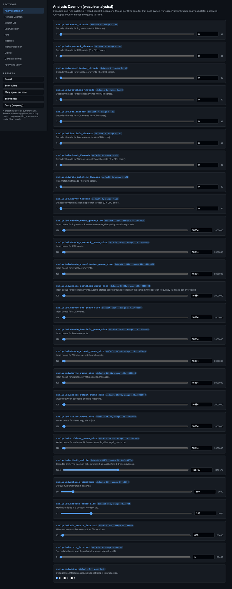
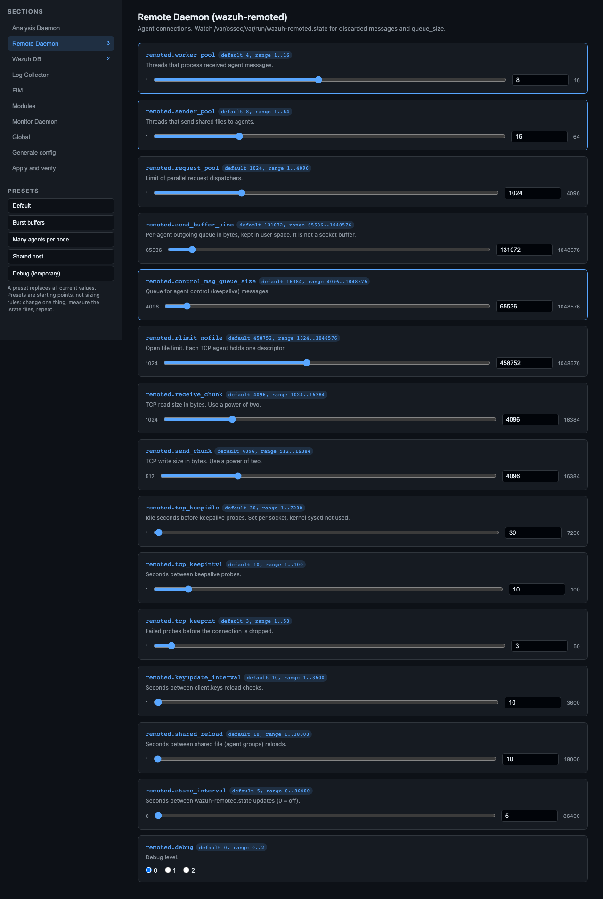
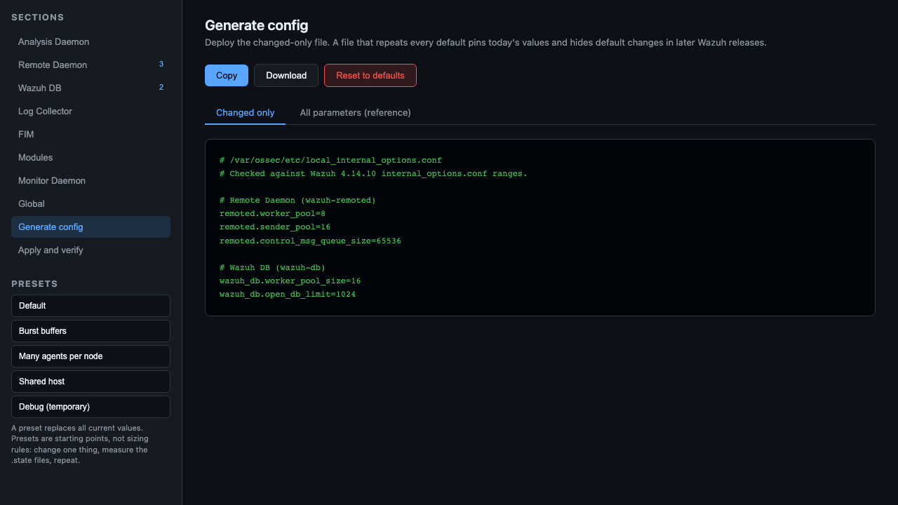
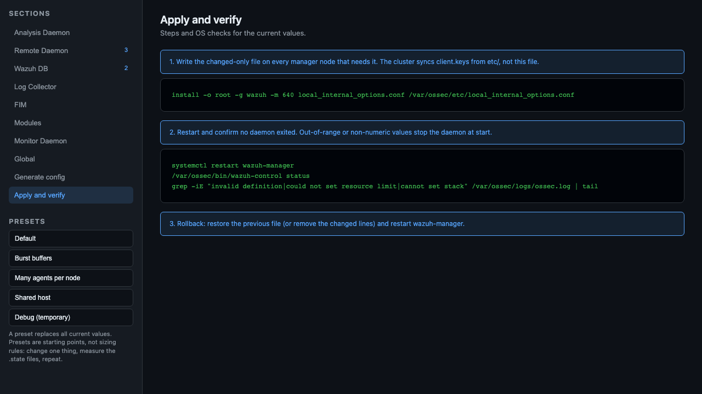

# wazuh-tuner


Local web UI that writes `/var/ossec/etc/local_internal_options.conf` for a Wazuh manager.
It lists 81 manager options with the defaults and ranges taken from the Wazuh 4.14.10 source,
blocks values the daemons would reject, and shows the commands to apply and check the result.

One file, Python standard library only, no install step.

For Wazuh 5 (`/etc/wazuh-manager/wazuh-manager-internal-options.conf`) use
[wazuh5-tuner](https://github.com/adampielak/wazuh5-tuner).

## Why ranges matter

Each daemon reads its options with `getDefine_Int()` (`src/shared/validate_op.c`). A value
outside the range, or anything that is not a plain non-negative integer, ends the daemon at
start with:

```
(2302): Invalid definition for <section>.<option>: '<value>'.
```

Two consequences people hit:

- `wazuh_modules.task_nice` is documented as -20..19, but the parser rejects the `-` sign, so
  any negative value stops `wazuh-modulesd`. The UI allows 0..19.
- `wazuh_modules.rlimit_nofile` has a minimum of 8192, not 1024.

`internal_options.conf` is replaced on upgrade. Put changes only in
`local_internal_options.conf`, which the daemons read first.

## Quick start

```bash
git clone https://github.com/adampielak/wazuh-tuner.git
cd wazuh-tuner
python3 wazuh-tuner.py
```

Open `http://127.0.0.1:7437`. The UI has no authentication and binds to localhost by default.
Use `--host 0.0.0.0` only on a trusted network, and `--port` to change the port.

## What it does

- One page per daemon: `analysisd`, `remoted`, `wazuh_db`, `logcollector`, `syscheck`,
  `wazuh_modules`, `monitord` and the global `wazuh.thread_stack_size`.
- Number inputs are clamped to the source range when you leave the field.
- **Generate config** gives the changed-only file. Copy and Download use it. The full
  listing is there for reference only: a file that repeats every default pins today's values
  and hides default changes in later releases.
- **Apply and verify** lists install, restart and check commands that match the values you
  changed (open file limits, queue counters, thread counts, whodata, debug).
- `--check` compares the built-in defaults with an `internal_options.conf` from a node.
  Run it after a Wazuh upgrade to see whether the table is still current:

```bash
python3 wazuh-tuner.py --check /var/ossec/etc/internal_options.conf
# OK: 81 parameters match /var/ossec/etc/internal_options.conf
```

- `POST /api/generate` with `{"values": {"remoted.worker_pool": 8}}` returns the file, or
  HTTP 400 with the list of rejected keys and values.

## Presets

A preset replaces all current values. Treat it as a starting point: change one thing,
watch the `.state` files, adjust.

| Preset | Changes | Use when |
|--------|---------|----------|
| Default | none | Reset |
| Burst buffers | analysisd input and writer queues to 65536 or 131072 | `*_dropped` grows during restarts, scans or rootcheck bursts |
| Many agents per node | remoted workers 8, senders 16, control queue 65536, wazuh-db workers 16, open DBs 1024 | more than about 1000 agents on one node |
| Shared host | analysisd pools capped at 1 to 4 threads | the manager shares the host and 0 (one thread per core) is too many |
| Debug (temporary) | `debug=1` on every daemon | short troubleshooting window |

## Facts behind the hints

Checked in the v4.14.10 source:

| Topic | Behaviour | Consequence |
|-------|-----------|-------------|
| `*.rlimit_nofile` | `setrlimit()` runs as root before the daemon drops privileges | The unit's `LimitNOFILE=65536` and `/etc/security/limits.conf` do not cap it. The ceiling is `fs.nr_open` (kernel default 1048576). |
| `*_threads = 0` | becomes the CPU core count, per pool | Setting 8 on a 32-core host lowers the thread count. |
| analysisd queues | allocate `size x 8` bytes of pointers at start | 2000000 slots cost about 16 MB before any event is queued. |
| `remoted.send_buffer_size` | user-space queue per agent | `net.core.wmem_max` does not apply. |
| `remoted.tcp_keep*` | set per socket | kernel `tcp_keepalive_*` sysctls are not used for agent sockets. |
| `wazuh.thread_stack_size` | `pthread_attr_setstacksize()` | No ulimit or systemd change. Memory grows with threads x stack. |
| `syscheck.max_audit_entries` | whodata audit rules | Check `auditctl -s` (backlog, lost). inotify limits apply to realtime mode, not whodata. |
| Cluster | the master syncs only `client.keys` from `etc/` | Deploy `local_internal_options.conf` to each node yourself. |

## Deploy

```bash
install -o root -g wazuh -m 640 local_internal_options.conf /var/ossec/etc/local_internal_options.conf
systemctl restart wazuh-manager
/var/ossec/bin/wazuh-control status
grep -iE "invalid definition|could not set resource limit" /var/ossec/logs/ossec.log | tail
grep -E "dropped|queue_usage|queue_size" /var/ossec/var/run/wazuh-analysisd.state
```

Keep the previous file. Rollback is restoring it and restarting `wazuh-manager`.

## Screenshots

Analysis daemon options with source ranges:


"Many agents per node" preset, changed options outlined, count per section in the sidebar:


Changed-only output:


Apply and verify commands for the current values:


## Tests

```bash
python3 -m unittest discover -s tests
```

## Scope

Manager options only. Agent options (`agent.*`, `windows.*`) and rarely tuned ones
(`analysisd.fts_*`, `remoted.request_*`, `maild.*`, `vulnerability-detection.*`) are not in
the UI. `logcollector` and `syscheck` here affect the manager's own collection, not agents.

## License

Apache-2.0

## Author

Adam Pielak (tick)
