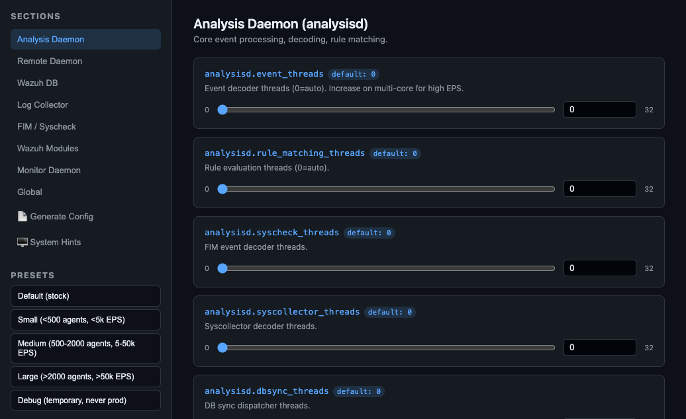
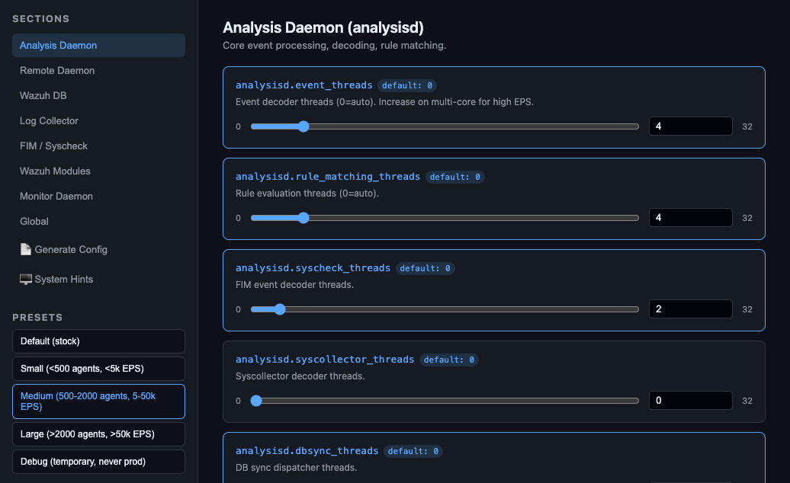
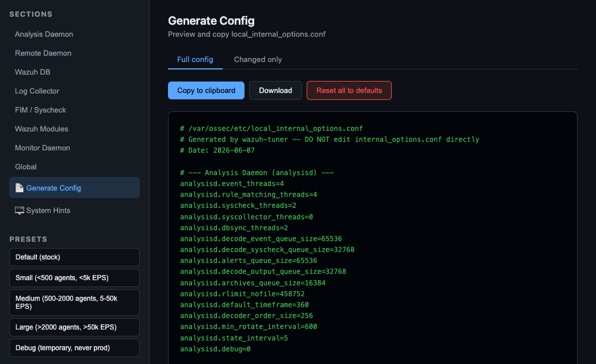
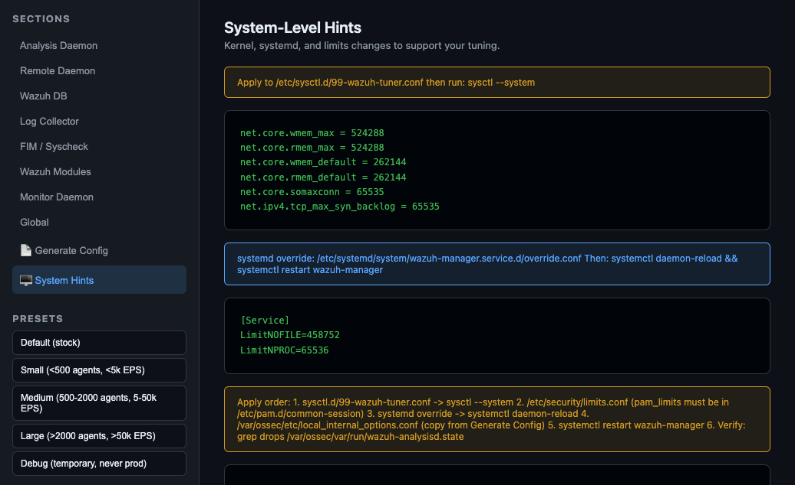
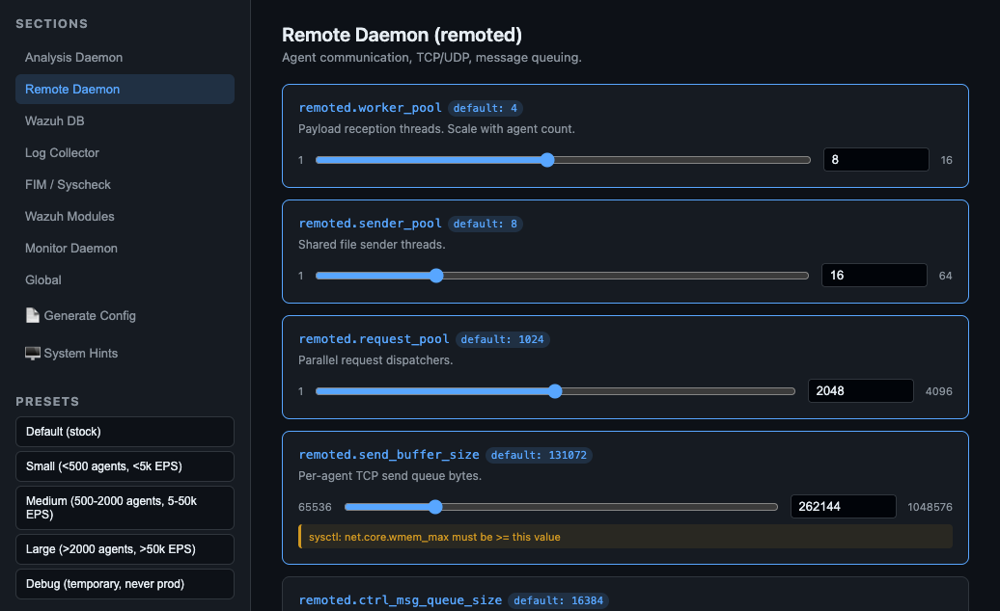

# wazuh-tuner

Web UI for tuning Wazuh 4.x `local_internal_options.conf` — generates ready-to-deploy config with matching OS-level hints (sysctl / limits.conf / systemd).

## What it does

- Interactive sliders and inputs for all ~75 `internal_options.conf` parameters across 8 daemon sections
- Preset profiles for common deployment sizes
- Generates `/var/ossec/etc/local_internal_options.conf` (full or changed-only diff)
- **System Hints** tab computes the required OS-level changes that must accompany your parameter choices: `sysctl.d`, `security/limits.conf`, systemd unit override

## Screenshots

### Overview — sidebar navigation and preset selection


### Analysis Daemon parameters — sliders with sysctl/systemd hints


### Medium preset applied — changed parameters highlighted in blue


### Generate Config — copy or download ready local_internal_options.conf


### System Hints — computed sysctl.d, limits.conf and systemd override


### Remote Daemon — TCP keepalive, buffer sizes, rlimit_nofile


## Why

`internal_options.conf` is overwritten on every Wazuh upgrade. Changes must go in `local_internal_options.conf`. Many parameters (FD limits, buffer sizes, inotify watches) also require kernel or systemd changes — the UI surfaces those automatically.

## Sections covered

| Section | Daemon | Key parameters |
|---------|--------|---------------|
| `analysisd` | Analysis Daemon | threads, queue depths, rlimit_nofile, debug |
| `remoted` | Remote Daemon | worker_pool, send_buffer_size, TCP keepalive, rlimit_nofile |
| `wazuh_db` | Wazuh DB | worker_pool_size, open_db_limit, commit times, rlimit_nofile |
| `logcollector` | Log Collector | input_threads, queue_size, max_files, rlimit_nofile |
| `syscheck` | FIM | rt_delay, max_audit_entries, default_max_depth |
| `wazuh_modules` | Modules | max_eps, task_nice, rlimit_nofile |
| `monitord` | Monitor Daemon | keep_log_days, size_rotate, compress |
| `wazuh` | Global | thread_stack_size |

## Presets

| Preset | Target |
|--------|--------|
| **Default** | Stock Wazuh defaults — clean baseline |
| **Small** | <500 agents, <5k EPS |
| **Medium** | 500–2000 agents, 5–50k EPS |
| **Large** | >2000 agents, >50k EPS |
| **Debug** | All daemons at `debug=1` — find issues, then revert |

## System Hints (automatic)

Based on current parameter values the UI generates:

- `/etc/sysctl.d/99-wazuh-tuner.conf` — `fs.file-max`, `net.core.wmem_max`, `net.core.rmem_max`, `fs.inotify.max_user_watches`
- `/etc/security/limits.conf` additions for the `wazuh` user
- `/etc/systemd/system/wazuh-manager.service.d/override.conf` with `LimitNOFILE`
- Ordered apply steps (sysctl → limits → systemd → restart)

## Requirements

```
python3
flask
```

Install:

```bash
pip3 install flask
```

## Run

```bash
python3 wazuh-tuner.py
```

Open `http://localhost:7437` in a browser.

## Deploy config

1. Tune parameters in the UI
2. Click **Generate** → copy or download the file
3. Place at `/var/ossec/etc/local_internal_options.conf` on the Wazuh manager
4. Apply OS-level changes from the **System Hints** tab
5. Restart: `systemctl restart wazuh-manager`

## Notes

- Never edit `/var/ossec/etc/internal_options.conf` — overwritten on upgrade
- `debug=2` generates extreme log volume; never leave in prod
- FD limit parameters require both `LimitNOFILE` in systemd **and** `fs.file-max` sysctl — the UI shows both
- Tested against Wazuh 4.14.5

## Author

Created by **tick** <tick@linuxmafia.pl>
